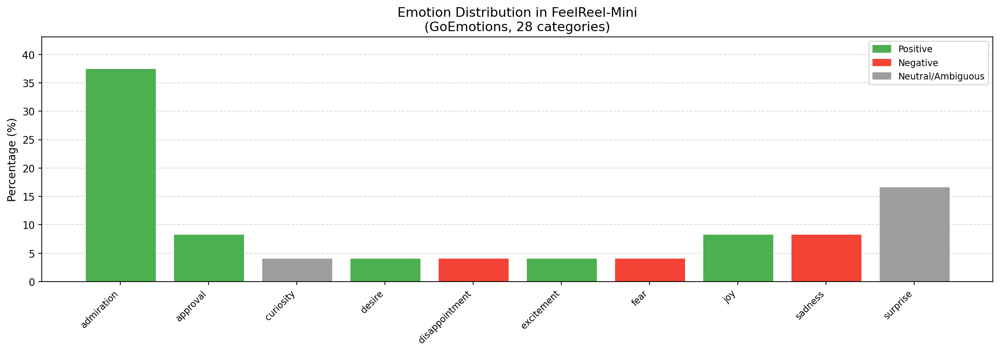
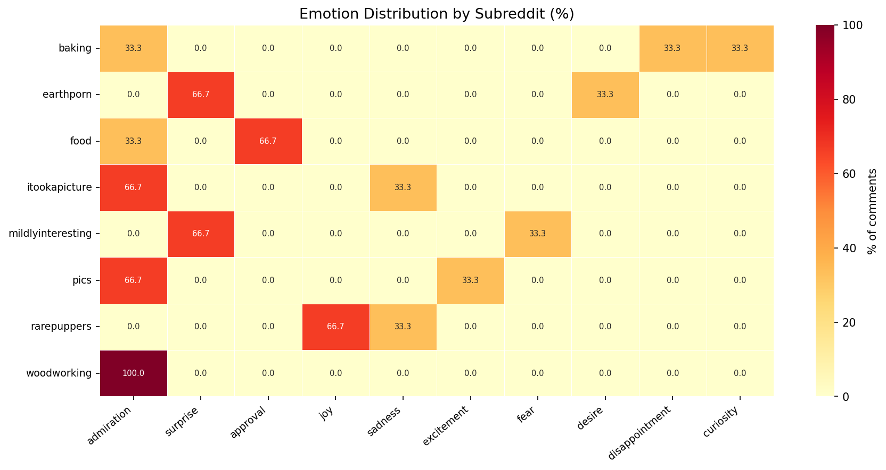

# FeelReel-Mini: Multimodal Emotion Understanding Pipeline

A personal recreation of the data curation pipeline I contributed to as a Research Assistant on a multimodal emotion understanding project submitted to CVPR 2024.

The original project, **FeelReel**, built a large-scale benchmark dataset of 450,000+ Reddit images with 5M+ user comments annotated with fine-grained emotion labels, emotion stimuli, and regions of interest. This repository reproduces the core pipeline at a smaller scale using publicly available tools and data.

---

## My Contributions to the Original Project

- **Reddit data collection** — designed and ran the scraping pipeline across 1,300+ subreddits
- **Human evaluation (MTurk)** — designed the survey instrument, recruited participants, and analyzed results comparing generated vs. real comments
- **Downstream experiments** — ran transfer learning evaluations on emotion classification datasets (ArtPhoto, Emotion6, EmoSet)

---

## Pipeline Overview

```
Reddit (image posts + comments)
        │
        ▼
[1] Scraper           — PRAW, requires free Reddit API credentials
        │
        ▼
[2] GoEmotions        — 28 fine-grained emotion labels per comment
        │
        ▼
[3] LLaVA (optional)  — "what in this image triggered [emotion]?"
        │
        ▼
[4] Analysis          — emotion distribution charts + sample outputs
```

This mirrors the attribute extraction pipeline from the original project:
- **GoEmotions** for pseudo emotion labeling
- **LLaVA** for emotion stimulus extraction via visual question answering
- Visualization matching the distribution analysis in the original paper

---

## Results

Emotion distribution across image-heavy subreddits (demo run, 8 subreddits):



Emotion patterns vary meaningfully by community:



Key finding: visual subreddits (r/earthporn, r/woodworking) skew toward **admiration** and **surprise**, while pet communities (r/rarepuppers) show more **joy** — consistent with the original FeelReel paper's finding that emotion distributions align strongly with content type. Running on the full Reddit dataset amplifies these patterns further.

---

## Setup

```bash
git clone https://github.com/nopgae/feelreel-mini.git
cd feelreel-mini
pip install -r requirements.txt
```

**Reddit API credentials (required for scraping):**
```bash
# 1. Go to https://www.reddit.com/prefs/apps → "create another app" → type: script
# 2. Set environment variables:
export REDDIT_CLIENT_ID=your_client_id
export REDDIT_CLIENT_SECRET=your_client_secret
```

**For LLaVA stimulus extraction (optional):**
```bash
brew install ollama
ollama pull llava
ollama serve   # run in a separate terminal
```

---

## Usage

```bash
# Full pipeline: scrape → label → visualize
python run_pipeline.py

# Skip re-scraping (reuse saved data)
python run_pipeline.py --skip-scrape

# Also run LLaVA emotion stimulus extraction
python run_pipeline.py --with-stimulus
```

---

## Tech Stack

| Component | Tool |
|---|---|
| Reddit scraping | PRAW (requires free Reddit API credentials) |
| Emotion labeling | `SamLowe/roberta-base-go_emotions` (RoBERTa, 28 labels) |
| Emotion stimulus | LLaVA 7B via Ollama (Metal GPU on Apple Silicon) |
| Visualization | matplotlib, seaborn |

---

## Project Structure

```
feelreel-mini/
├── scraper/              # Reddit image post + comment collection
├── annotation/           # GoEmotions pseudo-labeling
├── stimulus/             # LLaVA visual emotion stimulus extraction
├── analysis/             # Charts and sample output generation
├── data/                 # Collected data (gitignored)
└── outputs/              # Generated charts and tables
```

---

## Background

The original FeelReel dataset addresses a gap in affective computing: existing emotion datasets either focus narrowly on facial expressions or rely on expensive manual annotation. FeelReel leverages real user reactions to real-world images at scale, capturing a more authentic distribution of human emotional responses.

This mini version demonstrates the same core insight: that social media comment data, combined with modern vision-language models, can produce rich, interpretable emotion annotations without human labelers.
